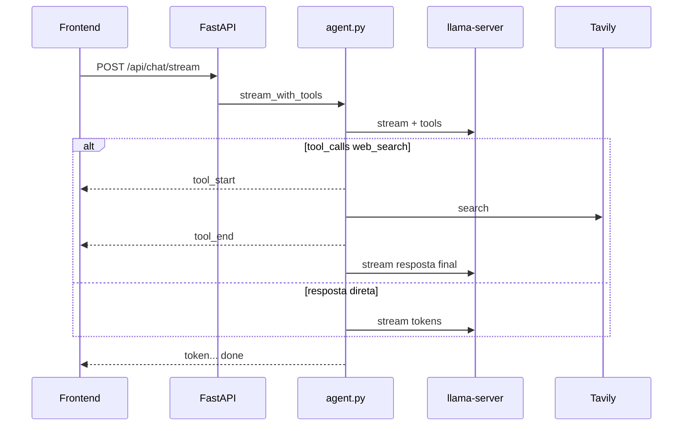

# Oficina LLM

Chat local na GPU para **estudo** — aprender a rodar um modelo de linguagem **localmente na placa**, sem depender de API na nuvem. O foco é entender o caminho completo — da VRAM e do `llama.cpp` até uma interface de chat usável — e não entregar um produto pronto para produção.

O que este repositório explora na prática:

- **Inferência na GPU NVIDIA** com [llama.cpp](https://github.com/ggml-org/llama.cpp) (`llama-server`), incluindo quantização GGUF, cache KV e limites reais de VRAM (sem fallback silencioso para CPU).
- **Orquestração** com Docker Compose: modelo, backend e frontend na mesma pilha.
- **Camada de aplicação** em FastAPI (histórico, contexto, streaming SSE) e React, como um “mini ChatGPT” apontando para `http://127.0.0.1`.
- **Extras opcionais** para experimentar agente com busca na web (Tavily) e anexo de arquivos — úteis para ver function calling e prompt com contexto extra.

O modelo padrão é o [Qwen3.5-4B Q4_K_M](https://huggingface.co/unsloth/Qwen3.5-4B-GGUF), baixado na primeira subida. Foi escolhido por caber em placas modestas (a partir de ~6 GB de VRAM) e ainda responder bem em português.

## Arquitetura

O navegador fala só com o backend FastAPI. O backend guarda as conversas, corta o histórico para caber no contexto e faz proxy para um `llama-server` local, com API compatível com a OpenAI.

```
Frontend (React) -> Backend (FastAPI, /docs) -> llama-server (Qwen3.5-4B Q4_K_M, GPU)
```

Contratos e invariantes do código estão no [AGENTS.md](AGENTS.md). VRAM, driver CUDA e variáveis de ambiente continuam detalhados abaixo.

## Requisitos

- Docker Desktop
- Backend WSL2 e a GPU NVIDIA visível no WSL (`nvidia-smi` dentro de um container deve listar a placa)
- GPU NVIDIA com 6 GB de VRAM ou mais (otimizado para GeForce RTX 4050 6 GB). O projeto não tem modo CPU
- Para desenvolver fora do Docker: Python 3.10 ou superior e Node.js 22

A imagem do llama-server é `ghcr.io/ggml-org/llama.cpp:server-cuda-b12019` (digest `sha256:c1d664830580e1651c1cc8d3bbc161af474800a56a83226e6e22f94bb8ba1c59`, llama.cpp b12019).

## Configuração

```powershell
copy .env.example .env
```

Copie a partir do [`.env.example`](.env.example) (perfil conservador: `LLAMA_CTX_SIZE=65536`, `LLAMA_KV_CACHE_TYPE=q8_0`). O [`.env`](.env) desta máquina usa tuning maior de contexto (`131072` / `q4_0`); o restante deste README descreve esse perfil. `LLAMA_BASE_URL=http://127.0.0.1:8080/v1` vale para o uvicorn no host. Dentro do Compose, o serviço `backend` sobrescreve isso para `http://llama:8080/v1`.

`API_KEY` vazio desliga a autenticação. Se for preenchida, as rotas `/api/*` exigem `Authorization: Bearer`. `GET /health` continua aberto. No Compose, o nginx do frontend injeta esse header; a chave não entra no JavaScript. No `npm run dev`, o proxy do Vite faz o mesmo a partir do `.env` da raiz.

## Subir (somente GPU)

```powershell
docker compose up --build
```

A primeira execução baixa o GGUF (alguns GB) e só então carrega os pesos. O healthcheck espera até 15 minutos antes de contar falha.

- Interface: http://127.0.0.1:8088
- API e Swagger: http://127.0.0.1:8000/docs
- llama-server: http://127.0.0.1:8080

Só o modelo, para testar com curl:

```powershell
docker compose up llama
```

O cache do modelo fica no volume `llama-cache` (`LLAMA_CACHE=/cache`). O SQLite fica no volume `backend-data`. `docker compose down` sem `-v` preserva os dois.

### Como o llama-server está ajustado para 6 GB de VRAM

- `-dev CUDA0 -ngl all -fit off`: todas as camadas na GPU e nenhum offload para CPU. Se não couber ou não houver GPU, o container falha em vez de cair para CPU em silêncio.
- `-fa on`: flash attention, menos memória no cálculo da atenção.
- `-ctk/-ctv` (`LLAMA_KV_CACHE_TYPE`): cache KV quantizado (`q4_0` ou `q8_0`), bem menos VRAM que f16. Nesta máquina, `q4_0` com `LLAMA_CTX_SIZE=131072` fica na ordem de grandeza de VRAM de `65536`/`q8_0`, com janela maior; se faltar VRAM, volte a `65536`/`q8_0` como no `.env.example`.
- `--no-mmproj`: não carrega o projetor multimodal (`mmproj-BF16.gguf`), que ocuparia VRAM à toa num chat só de texto.
- `-b 1024 -ub 512` (`LLAMA_BATCH_SIZE`, `LLAMA_UBATCH_SIZE`): batch moderado, para o buffer de computação não estourar a VRAM.
- `--threads` (`LLAMA_THREADS`) só afeta a parte de CPU (tokenização, sampling); 4 basta.

Medido aqui (RTX 4050 Laptop 6 GB, `.env` com `LLAMA_CTX_SIZE=131072` e `LLAMA_KV_CACHE_TYPE=q4_0`): cerca de 3,5 GB de VRAM em uso no total (incluindo o desktop), ~56 tokens/s na geração e ~195 tokens/s no prompt — confira de novo com `nvidia-smi` e `/slots` depois de subir. O Qwen3.5-4B aceita 262144 tokens nativos; 256K de cache KV não cabe nesta placa. O backend lê o mesmo `LLAMA_CTX_SIZE` que o llama-server.

### Driver NVIDIA e o compose

A imagem CUDA exige driver do host com CUDA >= 12.8. Com um driver mais antigo (566.x expõe 12.7), o `docker run` falha com `unsatisfied condition: cuda>=12.8`. O compose contorna isso com `NVIDIA_DISABLE_REQUIRE=true` e `LD_LIBRARY_PATH=/usr/lib/x86_64-linux-gnu:/app`. Sem o segundo, o llama.cpp usa a libcuda "compat" 570 da imagem e falha com `no CUDA-capable device is detected`. Com driver 570 ou mais novo, essas duas variáveis podem sair.


## Desenvolvimento local

Com o llama-server já no ar:

```powershell
cd backend
python -m venv .venv
.\.venv\Scripts\python -m pip install -r requirements.txt -r requirements-dev.txt
.\.venv\Scripts\python -m uvicorn app.main:app --reload --port 8000
```

```powershell
cd frontend
npm install
npm test
npm run dev
```

O Vite sobe em http://localhost:5173 e encaminha `/api` e `/health` para o backend em `http://127.0.0.1:8000`. Deixe `VITE_API_BASE_URL` vazio.

## Testar o llama-server

```powershell
curl.exe -s http://127.0.0.1:8080/health
curl.exe -s http://127.0.0.1:8080/v1/models
curl.exe -s http://127.0.0.1:8080/slots
curl.exe -s http://127.0.0.1:8080/v1/chat/completions -H "Content-Type: application/json" -d "{\"messages\":[{\"role\":\"user\",\"content\":\"Diga oi em uma frase.\"}],\"max_tokens\":64}"
curl.exe -N http://127.0.0.1:8080/v1/chat/completions -H "Content-Type: application/json" -d "{\"messages\":[{\"role\":\"user\",\"content\":\"Conte ate tres.\"}],\"max_tokens\":64,\"stream\":true}"
```

No PowerShell, o JSON do `-d` precisa ir entre aspas simples para o `curl.exe` receber as aspas duplas:

```powershell
curl.exe -s http://127.0.0.1:8080/v1/chat/completions -H "Content-Type: application/json" -d '{"messages":[{"role":"user","content":"Diga oi em uma frase."}],"max_tokens":64}'
```

Nesta build do llama.cpp, `--parallel N` cria N slots e `-c` é o contexto total do processo. Com `--parallel 1` e o `.env` desta máquina (`-c 131072`), a conversa usa os 131072 tokens. Subir `--parallel` sem subir `LLAMA_CTX_SIZE` na mesma proporção divide o contexto. Confira `n_ctx` em `/slots` depois de mudar. Sem `.env`, o Compose usa default interno `8192` só até você copiar e ajustar o arquivo.

O servidor sobe com `--reasoning off` quando `LLAMA_ENABLE_THINKING=false` (o padrão). O backend também manda `chat_template_kwargs.enable_thinking=false` e descarta blocos `<think>` se o modelo ainda os emitir. O raciocínio não entra na resposta gravada nem no histórico do prompt. Com `LLAMA_ENABLE_THINKING=true`, o stream SSE traz eventos `think` e o `done` inclui `thinking`; a interface mostra um bloco colapsável **Raciocínio** até recarregar a conversa.

A amostragem fica nas flags do servidor: `--temp 1.0 --top-p 0.95 --top-k 20 --min-p 0.0`. O backend só envia `temperature` quando o cliente pede, e sempre envia `max_tokens` (o valor do pedido ou `MAX_TOKENS_DEFAULT`, 8192 nesta máquina). O evento `done` traz `finish_reason`. Quando o valor é `length`, a interface avisa que a resposta foi cortada pelo limite.

## Busca na web

Com `WEB_SEARCH_ENABLED=true` e `TAVILY_API_KEY` preenchida, o backend oferece a ferramenta `web_search` ao llama-server. O servidor precisa subir com `--jinja` (já no Compose) para function calling. A chave Tavily fica só no backend; o JavaScript não a vê. Com a flag desligada, o chat segue como antes, sem tools.

O loop agente roda no FastAPI (`backend/app/services/agent.py`): cada rodada fala com o modelo em **stream**. Se o modelo pede `web_search`, o backend chama a [Tavily](https://tavily.com/), devolve `role: tool` ao modelo e em seguida streama a resposta final. Se ele responde direto, os tokens chegam um a um no SSE, igual com a busca desligada. Só a mensagem final do assistente é gravada no SQLite; turnos `tool` e mensagens intermediárias do agente não entram no histórico do prompt.

`POST /api/chat/stream` emite `tool_start` (nome e consulta) e `tool_end` (fontes; campo `error` se a Tavily falhar) além dos eventos habituais. A interface mostra “Buscando na web: …” e chips de fontes durante o stream; isso não persiste ao recarregar a conversa. `POST /api/chat` também passa pelo agente quando a busca está ligada, mas a resposta JSON não traz eventos intermediários de tool — só o texto final.

Se o modelo esgotar `AGENT_MAX_TOOL_ROUNDS` chamadas de ferramenta no mesmo turno, a API responde 502 no stream (`error`). Depois de incluir o resultado da busca no prompt, um contexto que não cabe mais no orçamento responde 413, como nas mensagens longas.



## Upload de arquivos

Com `FILE_UPLOAD_ENABLED=true` (padrão), a interface envia arquivos de texto/código e PDF em `POST /api/attachments` (`multipart/form-data`). O backend extrai o texto (PDF via `pypdf`) e grava só o conteúdo extraído e o nome no SQLite; o binário não fica no servidor.

Fluxo: **Anexar** no composer → upload → enviar a mensagem com `attachment_ids` no mesmo pedido de chat/stream. Se ainda não houver conversa, o upload cria uma rascunho e devolve `conversation_id`. Na bolha do usuário aparecem chips com o nome do arquivo; ao recarregar, o texto extraído não volta na API — só os nomes. O modelo vê blocos `Anexo: …` no prompt. **Tentar novamente** recompõe a última pergunta com os mesmos anexos. Anexo ou mensagem que não cabe no contexto responde 413.

Limites: `FILE_UPLOAD_MAX_BYTES`, `FILE_UPLOAD_MAX_FILES`, `FILE_UPLOAD_MAX_CHARS`. O nginx do frontend (`client_max_body_size 5m`) deve cobrir o tamanho máximo por requisição.

## API

| Método | Caminho | Função |
| --- | --- | --- |
| GET | `/health` | API no ar; `degraded` se o llama-server não responde |
| POST | `/api/chat` | Resposta JSON completa |
| POST | `/api/chat/stream` | Mesmo pedido, resposta em SSE (`meta`, `think`, `tool_start`, `tool_end`, `token`, `done`, `title`, `error`) |
| POST | `/api/attachments` | Multipart: extrai texto de arquivos; devolve `conversation_id` e ids dos anexos |
| GET | `/api/conversations` | Lista |
| GET | `/api/conversations/{id}` | Conversa e mensagens |
| PATCH | `/api/conversations/{id}` | Renomear |
| DELETE | `/api/conversations/{id}` | Apagar, com as mensagens |

O stream não usa `EventSource` porque o pedido é POST. O frontend lê o corpo com `fetch`. Parar a geração aborta o POST; o backend grava o texto parcial com status `interrupted`. Não há nova tentativa automática: isso repetiria a pergunta. O botão "Tentar novamente" manda `regenerate: true` e reusa a última mensagem do usuário, sem gravar outra. Respostas `interrupted` ou `error` continuam na tela e ficam de fora do prompt. Enquanto o modelo ainda não manda token, o stream emite `: ping` a cada 15 segundos. O `done` sai assim que a resposta é salva, com o título provisório. Se o slot ainda estiver livre, uma chamada curta tenta o título e o stream emite `title`.

O histórico enviado ao modelo cabe em `LLAMA_CTX_SIZE - max_tokens - CONTEXT_RESERVE_TOKENS`. Nesta máquina, `CONTEXT_RESERVE_TOKENS=1024` deixa margem para o template e para o turno do agente com busca. Entram sempre o system prompt e a mensagem atual. O restante volta do mais novo para o mais antigo, em pares cuja resposta está `complete`. Cada mensagem soma `MESSAGE_OVERHEAD_TOKENS` (padrão 4) além de `caracteres / CHARS_PER_TOKEN` (padrão 2.5, pensado para português). Uma única mensagem que não cabe responde 413. O mesmo 413 vale quando o llama-server recusa o prompt por estouro de contexto. Se algum turno antigo ficou de fora, a resposta traz `history_truncated: true`.

O `meta` traz `context_tokens` (essa estimativa do prompt) e `context_limit` (`LLAMA_CTX_SIZE`). A barra lateral mostra os dois, o percentual do limite e a taxa de geração. Durante a resposta a taxa conta os eventos `token`. No `done`, `prompt_tokens`, `completion_tokens` e `tokens_per_second` substituem a estimativa e a contagem quando o llama-server manda o usage: a ocupação final é a soma dos dois, e a taxa é `completion_tokens` pelo tempo desde o primeiro token visível. Sem usage, esses campos vêm nulos. Ao reabrir a conversa, o GET devolve de novo a estimativa por caracteres do que entra no prompt.

O system prompt é copiado para a conversa na criação. Mudar `SYSTEM_PROMPT` não reescreve conversas antigas. O título provisório é o começo da primeira mensagem. No stream ele segue no `done`; a chamada curta que tenta substituí-lo só corre depois, se o slot estiver livre. Se essa chamada falha ou o slot já foi ocupado, o provisório permanece. Um rename manual feito antes disso não é sobrescrito. `POST /api/chat` espera o título na resposta JSON.

## Testes

```powershell
cd backend
.\.venv\Scripts\python -m pytest
```

O pytest usa um modelo falso e um SQLite temporário. Cobre saúde, autenticação, chat JSON, SSE, truncamento, título, desconexão (`interrupted`), conflito 409, slot esgotado (503), o cascade do delete, o retry sem duplicar a pergunta, upload de arquivos (`backend/tests/test_attachments.py` e fluxo em `test_chat.py`), busca na web (`backend/tests/test_web_search.py`: stream com tool, resposta direta em vários tokens, busca desligada sem `tool_start`) e um cancelamento contra um uvicorn real.

O teste de integração fala com o llama-server de verdade e fica de fora da execução padrão:

```powershell
$env:LLAMA_BASE_URL = "http://127.0.0.1:8080/v1"
.\.venv\Scripts\python -m pytest -m integration -o addopts=
```

### Checklist manual da interface

- Enviar uma mensagem e ver os tokens chegarem aos poucos
- Parar a geração e, ao reabrir a conversa, ver o texto parcial
- Uma resposta com bloco de código mostra "Copiar" e copia só o código
- Renomear e apagar uma conversa, recarregar a página e ver o histórico
- Alternar tema claro/escuro
- Em largura de celular, a lista abre pela gaveta "Conversas"
- Com o llama-server parado, a tela mostra o erro e continua utilizável
- Com `WEB_SEARCH_ENABLED=true`, uma pergunta sobre algo atual mostra a consulta (“Buscando na web…”) e fontes no stream; ao recarregar, as fontes somem
- Com a busca ligada, uma pergunta que não precisa de web ainda deve chegar token a token
- Com `WEB_SEARCH_ENABLED=false`, não aparecem eventos de busca na rede nem na UI
- Anexar um `.txt` ou `.md`, enviar com uma pergunta e ver o chip do arquivo na mensagem; ao recarregar, o chip permanece
- Enviar só anexo (sem texto) com uma pergunta implícita ou texto curto; PDF escaneado sem texto deve mostrar erro claro no upload

No Compose, os tokens precisam chegar aos poucos também em http://127.0.0.1:8088. O nginx do frontend desliga o buffer do proxy de `/api/`.

## Variáveis

Llama: `LLAMA_PORT`, `LLAMA_CTX_SIZE`, `LLAMA_THREADS`, `LLAMA_PARALLEL`, `LLAMA_KV_CACHE_TYPE`, `LLAMA_BATCH_SIZE`, `LLAMA_UBATCH_SIZE`, `LLAMA_HF_REPO`, `LLAMA_ENABLE_THINKING`.

Backend: `LLAMA_BASE_URL`, `LLAMA_API_KEY`, `LLAMA_MODEL` (vazio usa o primeiro id de `/v1/models`), `LLAMA_TIMEOUT_SECONDS`, `MAX_TOKENS_DEFAULT` (8192 nesta máquina; 2048 no `.env.example`), `MESSAGE_OVERHEAD_TOKENS`, `CONTEXT_RESERVE_TOKENS` (1024 nesta máquina; 256 no `.env.example` — entram no orçamento `LLAMA_CTX_SIZE - max_tokens - reserva`), `CHARS_PER_TOKEN`, `SYSTEM_PROMPT`, `DATABASE_URL`, `API_KEY`, `CORS_ORIGINS`, `LOG_LEVEL`.

Busca na web: `WEB_SEARCH_ENABLED`, `TAVILY_API_KEY`, `WEB_SEARCH_MAX_RESULTS`, `WEB_SEARCH_MAX_CHARS`, `AGENT_MAX_TOOL_ROUNDS`. Com `WEB_SEARCH_ENABLED=true`, a chave Tavily é obrigatória; a execução fica no backend, não no JavaScript.

Upload: `FILE_UPLOAD_ENABLED`, `FILE_UPLOAD_MAX_BYTES`, `FILE_UPLOAD_MAX_FILES`, `FILE_UPLOAD_MAX_CHARS`.

Frontend de desenvolvimento: `VITE_API_BASE_URL` vazio, para o browser usar a mesma origem e o proxy do Vite. A imagem Docker também deixa a URL vazia. `API_KEY`, quando preenchida, é injetada pelo proxy e não vai para o bundle.

## O que a primeira subida mostrou

Nesta máquina (RTX 4050 Laptop 6 GB), com a imagem `server-cuda-b12019`:

**Primeira boot (sem `.env` ou só defaults do Compose):** `GET /slots` pode mostrar `n_ctx` **8192** — é o fallback do `docker-compose.yml`, não o alvo desta instalação.

**Com o `.env` local aplicado ao Compose:** espere um slot com `n_ctx` **131072** (`n_slots = 1`, `kv_unified = false`), `LLAMA_KV_CACHE_TYPE=q4_0` e o mesmo id de modelo `unsloth/Qwen3.5-4B-GGUF:Q4_K_M`.

Observações gerais da primeira vez que o stack subiu:

- Com `--reasoning off`, a resposta de teste foi só `Olá!`, sem bloco `<think>`.
- O stream devolveu deltas SSE (`Um`, `.`, `Dois`, …) e terminou com `data: [DONE]`.
- Reiniciar o container carregou o GGUF já presente em `/cache/models--unsloth--Qwen3.5-4B-GGUF`, sem baixar de novo.
- O repositório também traz o projetor multimodal `mmproj-BF16.gguf`. O compose usa `--no-mmproj`, então ele não é carregado e a VRAM fica livre para o contexto.
- A geração ficou em torno de 56 tokens por segundo, com cerca de 3,5 GB de VRAM em uso (ordem de grandeza; confira de novo após mudar contexto ou cache KV).

## Riscos

- O GGUF Q4_K_M do 4B fica na casa de uns 2,5–3 GB; o cache KV de **131072** tokens com **q4_0** soma da ordem de ~1 GB de VRAM (perfil desta máquina). Como `-fit off` impede o fallback para CPU, se o container morrer por falta de VRAM, baixe `LLAMA_CTX_SIZE`, troque para `q8_0` (como no `.env.example`), ou deixe `LLAMA_PARALLEL` em 1 — sempre com o mesmo valor no backend. A janela nativa de 262144 tokens não cabe nesta placa.
- A primeira subida baixa o modelo. Sem o volume, o download recomeça.
- Turnos antigos saem do prompt quando o contexto enche. A interface avisa. Não há resumo automático.
- Outros programas usando a GPU (jogos, navegador com aceleração) reduzem a VRAM livre. Se o llama-server não subir, feche-os ou baixe `LLAMA_CTX_SIZE`.
- Uma mensagem maior que o orçamento volta 413, sem cortar a pergunta em silêncio.
- SQLite aceita um escritor por vez. Serve para uma pessoa. Vários processos da API no mesmo arquivo não são o objetivo.

## Fora deste recorte

RAG, cadastro e login, embeddings, resumo automático do histórico e testes de browser automatizados.
